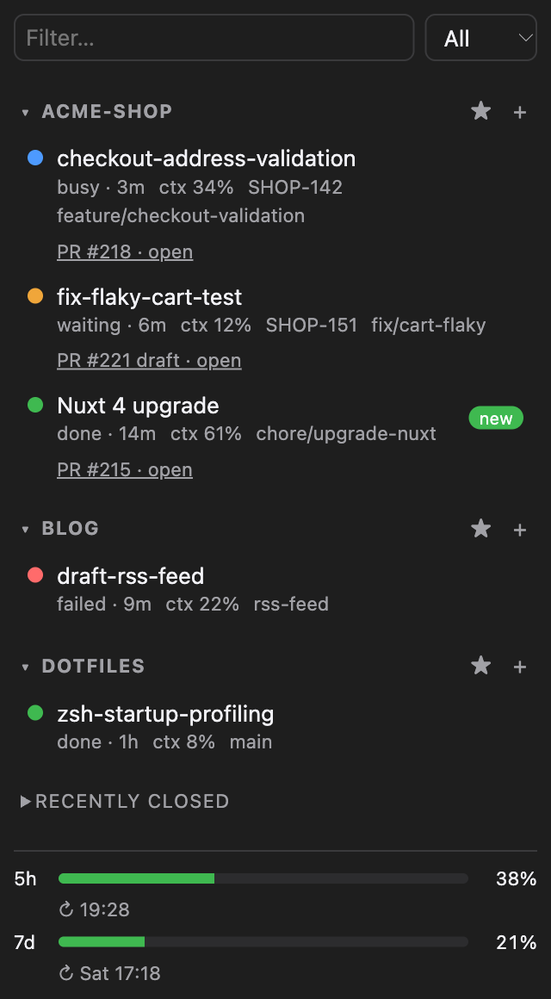
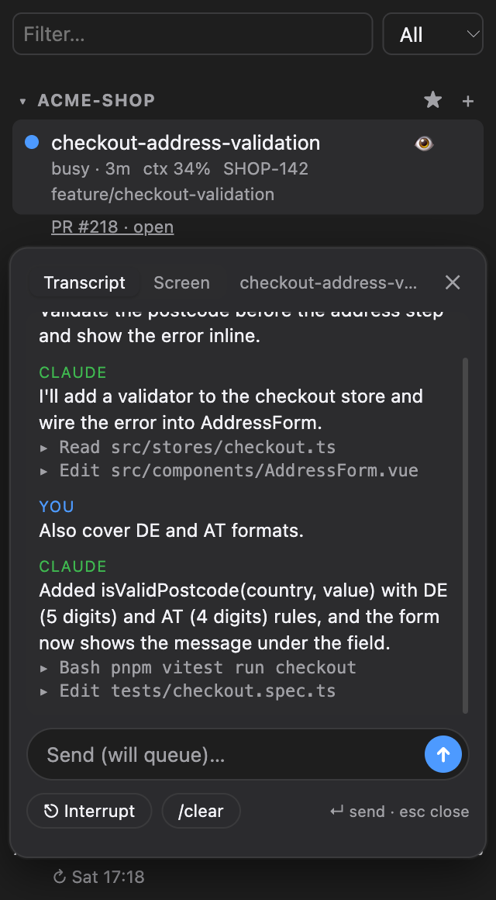

# iterm-claude-sidebar

  
  &nbsp;&nbsp;
  

An iTerm2 toolbelt panel that lists your open [Claude Code](https://claude.com/claude-code) sessions grouped by project, shows their state (busy / waiting / done / failed) and focuses the session when you click it.

> Reads Claude Code's undocumented `~/.claude/sessions/*.json` files, which may change between releases.

## Features
- State per session; "new" badge when one finished while you were elsewhere; macOS notification on waiting/failed
- Branch, Jira-style key, PR (via `gh`, cached 2 min), context usage %, time in state
- Filter, collapsible and pinnable projects, hide old done sessions, `+` starts `claude` in the project root
- Rename sessions in the sidebar (✎ or F2; empty resets): an alias stored by the sidebar, Claude and the tab titles keep the original name
- Remote use behind a reverse proxy with a responsive dashboard layout (see below)
- Live terminal (⌨ in the peek): the session's real screen in the browser, with colors and real keystrokes, so permission prompts, menus, slash-command completion and multi-line paste work like in iTerm
- Peek (👁): a floating card with the session's transcript or live screen, plus a message box, Interrupt (Esc) and `/clear` (asks twice). Sending never focuses the session; it asks first if the session is waiting for input or you have unsent text at its prompt (single-line messages only)
- Recently closed sessions (last 15) with `claude --resume`
- Status bar component and a `claude_next_waiting()` function you can bind to a key

## Install
Requires iTerm2 with *Settings > General > Magic > Enable Python API*, Python 3 and (optionally) `gh`.

    python3 -m venv .venv && .venv/bin/pip install -r requirements.txt
    .venv/bin/python sidebar.py        # then View > Show Toolbelt > Claude Sessions
    ./install-launchagent.sh           # optional: start at login, restart if it exits

The log is `~/Library/Logs/iterm-claude-sidebar.log`. Remove with
`launchctl bootout gui/$(id -u)/io.github.gluebi.iterm-claude-sidebar`.

### Failed state (optional hook)
Add to `~/.claude/settings.json` (use the absolute path of `hooks/claude-failed.sh`): `StopFailure` and `PostToolUseFailure` run it with `set`; `Stop`, `UserPromptSubmit` and `SessionStart` run it with `clear`.

### 5h / 7d usage footer (status line tap)
Claude Code only hands the plan limits to its status line command, so `statusline-tap.py` records them and then runs your real status line unchanged. In `~/.claude/settings.json` set
`statusLine.command` to `/absolute/path/statusline-tap.py <your existing status line command>` (or just the tap if you have none). The tap writes `~/.claude/rate-limits.json`; the sidebar never depends on what your status line prints. Subscription plans only; values appear after a session's first response.

### Manual iTerm setup
- Status bar: Profiles > Session > Status bar enabled > Configure > drag in "Claude Sessions"
- Hotkey: Settings > Keys > Key Bindings > Action "Invoke Script Function" > `claude_next_waiting()`

## Remote access (behind Caddy)
By default the daemon only listens on `127.0.0.1`. To use it from another device through a reverse proxy such as Caddy running on another machine of your network, create `~/Library/Application Support/iterm-claude-sidebar/config.json` on the Mac:

    {
      "bind": "0.0.0.0",
      "allow_from": ["192.168.1.10"],
      "allowed_hosts": ["sidebar.example.org"]
    }

- `allow_from`: the proxy's address (or CIDR). Required whenever `bind` is not loopback; the daemon refuses to start otherwise. Everything else gets a 403.
- `allowed_hosts`: the host names visitors use (the `Host` header Caddy passes on). Requests with any other `Host` or a foreign `Origin` are rejected.

Then restart (`launchctl kickstart -k gui/$(id -u)/io.github.gluebi.iterm-claude-sidebar`) and put authentication and TLS in the proxy, see [`docs/Caddyfile.example`](docs/Caddyfile.example). The daemon itself has no login.

On a wide screen the page becomes a dashboard with the peek docked on the right; on a phone it stays a single column. Remotely, clicking a session opens its peek (raising a window on the Mac would be pointless), and PR chips are normal links. Peek, send, interrupt, `/clear`, rename, new and resume all work.

**Security.** Whoever passes the proxy's login can type into every Claude session on the Mac, and sessions started with `--dangerously-skip-permissions` run commands without asking, so treat the login like shell access: strong credentials, TLS, and no exposure of the proxy to the internet unless you accept that. Traffic between the proxy and the Mac is plain HTTP, so keep it on a network you trust.

## Terminal view
⌨ in the peek header opens the session's live screen full-page. The daemon reads the screen through iTerm2's API (cell styles included), paints it into [xterm.js](https://github.com/xtermjs/xterm.js) and types your keystrokes back into the session, so it behaves like the terminal itself: arrow keys, Tab, Shift+Tab, Ctrl+C, slash-command menus, permission prompts. Pastes are sent as bracketed pastes, so multi-line text isn't submitted line by line. A key bar covers Esc, Tab, arrows, Enter and Ctrl+C on touch screens. `Ctrl+]` closes the view (Esc goes to the session).

- The real session is never resized: the browser scales the font to fit its screen size.
- No scrollback and no mouse support, only the visible screen; use the Transcript tab for history.
- How fast typing echoes depends on the session: Claude's own redraw usually takes 0.2 to 0.5 s for a session in a background tab; the relay adds only a few milliseconds.
- Each view starts with a one-time ticket (30 s) fetched through the protected API, because browsers cannot set the `X-Sidebar` header on a WebSocket; the handshake also needs an allowed `Origin`.
- This is full keyboard access to the session. Behind a proxy it is as sensitive as a shell on the Mac (see Security above).

## Notes
- Context % assumes a 1M-token window (`CONTEXT_WINDOW` in `state.py`)
- Notifications use `osascript`, so clicking one doesn't focus the session
- `python state.py` runs the self-check

## Contributing
Issues and pull requests are welcome. This is a small tool, so changes that keep it small are the easiest to merge.

**Setup**

    python3 -m venv .venv && .venv/bin/pip install -r requirements.txt
    launchctl bootout gui/$(id -u)/io.github.gluebi.iterm-claude-sidebar   # only if you installed the LaunchAgent: the daemon uses a fixed port (47831)
    .venv/bin/python sidebar.py

iTerm2 needs *Settings > General > Magic > Enable Python API*. There is no build step: `static/index.html` is served as is, and the page reloads itself when the file changes. Restart `sidebar.py` after editing the Python files.

**Checks**
- `python state.py`, `python access.py` and `python term.py` run the assert-based self-checks; they need neither iTerm2 nor Claude Code.
- Try UI changes against your own sessions and in a narrow window (the toolbelt is about 300 px wide), in light and dark mode.

**Guidelines**
- Stay with the standard library, `iterm2` and `aiohttp`; avoid new dependencies and front-end tooling.
- Give new interactive elements a `data-testid` (`{component}-{element}`, kebab-case), keep them keyboard-accessible with proper ARIA, and respect `prefers-reduced-motion`.
- Anything under `/api/` goes through the `protect` middleware (allowed peer, `Host` and `Origin`, plus the `X-Sidebar` header). Anything that types into a terminal must keep asking first when the session is waiting for input or has unsent text.
- Comment only the *why*, in one short line.
- Never put real project, branch or ticket names, tokens or paths in code, tests or screenshots. The README screenshots come from invented data.
- Keep pull requests focused, say what you tested, and write commit messages in the imperative.

**Reporting a bug**
Include your Claude Code and iTerm2 versions, since the sidebar reads Claude Code's undocumented session files, plus the relevant lines of `~/Library/Logs/iterm-claude-sidebar.log` if you use the LaunchAgent.

## License
MIT. The bundled `static/vendor/xterm.js` and `xterm.css` are xterm.js 5.5.0 (MIT, see `static/vendor/LICENSE-xterm`).
